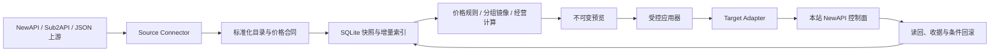

# RelayOps 架构设计

## 1. 设计目标

RelayOps 将“观察上游”和“修改本站”分为两个阶段，并始终位于 API 数据面之外。核心目标是：上游短暂不可用时保留最后可信状态；需要写入时先预览、再比较、再应用、再读回；控制台故障不影响 NewAPI 对外服务。



## 2. 进程与模块

| 模块 | 目录 | 责任 |
|---|---|---|
| HTTP/API | `internal/httpapi` | 管理认证、API 合同、请求边界、静态前端 |
| 上游连接器 | `internal/connectors` | 获取并标准化目录、价格、余额、用量和诊断证据 |
| 采集器 | `internal/collector` | 合并并发采集、调度、增量差异和可信快照 |
| 凭据 | `internal/credentials`, `internal/secrets` | 加密存储、续约、浏览器配对和脱敏状态 |
| 存储 | `internal/store` | SQLite 事务、设置、收据、保留策略和本地写入序列化 |
| 价格自动化 | `internal/automation` | 规则模拟、提案、应用和条件回滚 |
| 分组镜像 | `internal/mirrorservice` | 模型集合、逐模型合同、计费模式和例外模型同步 |
| 一键上架 | `internal/listing` | 渠道创建、价格合同、镜像/映射联动和回滚 |
| 目标适配器 | `internal/targets` | NewAPI 控制面读取、CAS 写入、渠道操作和读回 |
| 经营智能 | `internal/intelligence`, `internal/ledgersync` | 增量经营数据、成本证据、缓存和账本同步 |
| 前端 | `web/src` | 管理控制台和副屏模式 |

## 3. 数据面隔离

RelayOps 不接收或转发用户模型调用。生产部署应使用独立容器、独立 SQLite 数据目录、CPU/内存限制和独立网络。NewAPI、PostgreSQL、Redis、Caddy 和业务 worker 不应成为 RelayOps Compose project 的依赖。

这带来三个性质：

1. RelayOps 重启不会中断 API 请求；
2. 自动化可以整体关闭，但目录和历史仍可读取；
3. 回滚 RelayOps 二进制不要求回滚 NewAPI 数据库。

## 4. 采集与可信快照

连接器输出统一的 `CatalogSnapshot`：分组、模型、余额和 `Evidence`。详细连接器还会输出请求级 `CollectionDiagnostics`，但诊断只保存方法、端点类型、状态码、耗时、错误分类和响应哈希，不保存 Header、Cookie、Token、查询串或响应正文。

采集器将“采集尝试”和“最后成功快照”分开：

- 网络超时、DNS、TLS、限流和上游 5xx 不覆盖旧快照；
- 证据不完整时不下架旧模型；
- 只有完整、可解释的新目录才进入语义差异计算；
- 同一供应商并发请求合并为一个采集任务；
- 目录无语义变化时不触发下游全量重算。

## 5. 价格模型

RelayOps 使用十进制字符串保存金额和倍率，避免浮点比较造成重复变更。

NewAPI 文本模型常见语义：

- 输入单价 = `ModelRatio * $2 / 1M tokens`；
- 输出单价 = `ModelRatio * CompletionRatio * $2 / 1M tokens`；
- `GroupRatio` 是最终用户分组倍率；
- 分组逐模型合同保存基础模型价格/倍率，分组镜像不会把绝对美元价格误写成倍率。

图片、音频、视频和任务模型通过 `billing_mode`、`billing_unit`、`fixed_duration_seconds` 和价格函数表达。按秒模型必须保留 `per_second` 及实际时长；固定 15 秒套餐应保持按次固定价，不能仅凭模型名推断。

## 6. 分组镜像

完整镜像策略由以下独立维度构成：

- `sync_model_additions`：上游新增模型时加入本站受管渠道；
- `sync_model_removals`：上游下架时从本站受管渠道移除；
- `sync_model_prices`：同步逐模型基础价格合同；
- `sync_billing_mode`：同步按 token、按次、按秒等计费语义；
- `excluded_models`：任何上架、下架或价格变更均跳过的例外模型；
- `empty_group_action=remove_managed_models`：上游分组为空时清空受管模型，而不是报错；
- `sync_group_ratio=false`：镜像不修改利润控制用的本站分组倍率。

价格映射和分组镜像分工明确：价格映射维护 GroupRatio 规则；完整镜像维护模型集合与逐模型合同。两条链路不能同时拥有同一字段。

## 7. 写入协议

所有重要远程修改遵循：

```text
读取基线 -> 计算预览 -> 冻结 expected hash/revision -> 获取本地租约
-> 比较当前状态 -> 逐步写入 -> 每步读回 -> 保存 change-set
-> 最终读回 -> 成功或条件回滚
```

写入协议必须具备：

- CAS/hash 或 revision 比较，拒绝覆盖管理员并发修改；
- operation key 与请求 ID，支持幂等恢复；
- 本地 lease/fencing token，避免两个 worker 同时写同一目标；
- 每一步的 expected/desired/readback hash；
- 仅在读回仍匹配本次结果时执行回滚；
- 全局 `RELAYOPS_REMOTE_WRITES_ENABLED` 和运行时无人值守开关。

## 8. 缓存与资源控制

- 目标目录、Option、渠道和分组模型合同使用有界共享读缓存；
- 写入或检测到外部变化后只失效对应目标的缓存；
- 经营数据以游标/版本增量更新，普通前端刷新读取已有快照；
- 后台 worker 数量、请求超时、SQLite 保留和容器资源均可限制；
- 服务器不应执行构建、VACUUM、数据库复制、全量草案生成或压力测试。

## 9. 错误语义

| 类别 | 行为 |
|---|---|
| 网络抖动、TLS、DNS、5xx、限流 | 保留旧快照，按计划重试，不产生操作失败风暴 |
| 证据不完整 | 不更新、不下架，等待完整采集 |
| 鉴权失败或权限拒绝 | 标记需要管理员处理 |
| 合同变化、非法单位或非法价格 | 停止相关规则并提供结构化诊断 |
| SQLite 短忙锁 | 本地事务内有限重试 |
| SQLite 持续忙锁或非忙锁错误 | 保留明确活动和诊断 |
| CAS/预览过期 | 不写入，要求生成新预览 |

## 10. 扩展边界

上游读取扩展实现 `connectors.Connector`；需要请求级证据时实现 `DetailedConnector`。本站写入扩展实现 `targets.Adapter`，再按能力选择实现价格 Option、分组模型合同、渠道、可见性和受控管理接口。两类适配器不能互换。

详细接口见[适配器合同](ADAPTER_CONTRACTS.md)，分组价格公式见[分组模型定价合同](GROUP_MODEL_PRICING.md)，NewAPI 目标扩展见[NewAPI 目标集成合同](NEWAPI_TARGET_INTEGRATION.md)。
