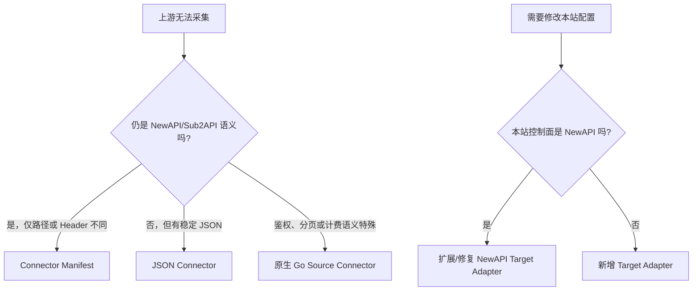

# 连接器与目标适配器开发指南

## 1. 先分清两类适配器

| 类型 | 方向 | 主要接口 | 是否允许写远程 |
|---|---|---|---|
| Source Connector | 上游 -> RelayOps | `connectors.Connector` | 否，只读采集和登录/续约 |
| Target Adapter | RelayOps -> 本站控制面 | `targets.Adapter` 及可选接口 | 是，必须经过预览、CAS 和远程写开关 |

NewAPI 和 Sub2API 均已有上游 Source Connector。当前 Target Adapter 只内置 NewAPI；要让 Sub2API 作为“本站控制面”，需要单独实现目标适配器，不能把 Sub2API 采集器直接复用为写入器。

## 2. 兼容方式决策树



优先使用声明式方案。只有声明式能力不能表达真实语义时，才增加 Go 代码。

仓库中的 [`examples/newapi-fork.manifest.json`](../examples/newapi-fork.manifest.json) 与 [`examples/catalog.connector.json`](../examples/catalog.connector.json) 是可直接修改的脱敏起点，并由 Go 合同测试持续校验。

## 3. 用 Codex 分析魔改站点

不要把生产 Cookie、Token、密码、私钥、完整 HAR 或数据库交给 Codex。建议流程：

1. 在浏览器开发者工具中定位目录、分组、价格、余额和用量请求；
2. 复制请求方法、同源相对路径、必要 Header 名和脱敏后的响应结构；
3. 删除 Cookie/Header 值、查询 token、用户信息、余额真值和业务域名；
4. 将响应改造成最小 JSON fixture，同时保留分页、空分组、0 元、按秒、固定时长和错误 envelope；
5. 让 Codex 先判断 Manifest、JSON Connector 或 Go connector 哪条路线最小；
6. 先写失败的合同测试，再修改实现；
7. 本地运行全量测试和 NewAPI 夹具，远程写、worker、自动化均关闭；
8. 仅对测试账号执行一次只读采集，比较模型数、分组数、价格单位和响应哈希；
9. 如需写入，使用一次性目标实例执行 preview -> apply -> readback -> rollback；
10. 审查日志中不存在凭据和响应正文后再提交 PR。

可复用提示词：

```text
你正在为 RelayOps 增加一个上游兼容适配。先读取 connectors.Connector、
JSONConnectorSpec、ConnectorManifest 和现有合同测试。以下资料已脱敏，禁止
推断或硬编码真实域名、账号、Token、价格或模型清单。请先判断能否仅用
Connector Manifest；其次判断 JSON Connector；只有两者无法表达真实协议时
才设计 Go connector。必须先添加 fixture 和失败测试，覆盖正常、空分组、
0 元、分页、401/403、429、5xx、单位缺失和响应结构变化。实现不得执行远程
写入，不得记录 Header/Cookie/正文，并说明本地隔离验收命令。
```

## 4. Connector Manifest

Manifest 用于保留 NewAPI/Sub2API 原生解析语义，只覆盖同源路径、Header、登录字段和少量 JSON 字段位置。它不允许脚本、模板、跨源 URL 或明文秘密。

示例：

```json
{
  "schema_version": "relayops.connector-manifest/v1",
  "name": "newapi-fork-v1",
  "adapter_family": "newapi",
  "origins": {
    "schemes": ["https"],
    "hosts": ["api.example.com"]
  },
  "auth": {
    "header": "Authorization",
    "scheme": "bearer",
    "user_header": "New-Api-User"
  },
  "capabilities": {
    "status": {"paths": ["/api/status", "/api/setting"]},
    "pricing": {"paths": ["/api/pricing"]},
    "balance": {
      "paths": ["/api/account/balance"],
      "contract": "json",
      "json_paths": {
        "amount": "data.balance",
        "currency": "data.currency"
      }
    }
  }
}
```

重要限制：

- origin 在导入和使用时都会重新校验；
- 通配 host 仅匹配子域，不匹配根域；
- capability path 必须是同源相对路径；
- `json` 合同目前只用于 NewAPI 的 balance/usage；
- 其他自定义文档应使用 JSON Connector。

## 5. JSON Connector

JSON Connector schema version 为 `1`，支持有界 GET/POST、页码或 cursor 分页、字段路径、常量、余额和完整价格函数。未知字段会被拒绝。

```json
{
  "schema_version": 1,
  "name": "example-json-catalog",
  "limits": {
    "timeout_seconds": 25,
    "max_response_bytes": 2097152
  },
  "endpoints": [
    {
      "name": "catalog",
      "method": "GET",
      "path": "/api/catalog",
      "headers": {
        "Authorization": {"credential_ref": "authorization"}
      },
      "groups": {
        "items_path": "data.groups",
        "external_id": {"path": "id", "required": true},
        "name": {"path": "name", "required": true},
        "ratio": {"path": "ratio"},
        "model_ids": {"path": "models"}
      },
      "models": {
        "items_path": "data.models",
        "external_id": {"path": "id", "required": true},
        "name": {"path": "name", "required": true},
        "group": {"path": "group_id"},
        "billing_mode": {"path": "billing.mode"},
        "price_function": {
          "currency": {"path": "pricing.currency"},
          "input_per_1m": {"path": "pricing.input_per_1m"},
          "output_per_1m": {"path": "pricing.output_per_1m"},
          "per_request": {"path": "pricing.per_request"},
          "per_second": {"path": "pricing.per_second"}
        }
      }
    }
  ]
}
```

限制包括：最多 16 个 endpoint、50 页、16 MiB 单响应、2 分钟超时。敏感 Header 只能引用加密凭据，不能写静态值；凭据引用允许 `authorization`、`cookie`、`user_id`、`headers.*`、`local_storage.*` 和 `session_storage.*`。

## 6. 新增 Go Source Connector

最低接口：

```go
type Connector interface {
    Name() string
    Collect(ctx context.Context, supplier domain.Supplier) (domain.CatalogSnapshot, error)
}
```

推荐同时实现 `CollectDetailed`，输出请求级脱敏证据。开发步骤：

1. 在 `internal/connectors` 添加实现和 fixture；
2. 使用 `netguard.SameOriginClient`，禁止私网/元数据 SSRF；
3. 通过凭据服务加载加密凭据，验证 credential origin；
4. 为每个远程请求设置有界 deadline、响应大小和分页上限；
5. 使用 `json.Decoder.UseNumber` 或 decimal 字符串，不用 `float64` 处理价格；
6. 标准化为 `GroupOffer`、`ModelOffer`、`PriceFunction` 和 `BalanceState`；
7. 生成稳定的语义 hash，不把响应顺序当成变化；
8. 在 `connectors.Factory.ForSupplier` 注册 adapter 名；
9. 添加自动识别时，探针必须轻量、匿名、同源且不产生副作用；
10. 覆盖合同变化、单位歧义、分页中断、空目录和鉴权失败测试。

## 7. NewAPI 上游合同

原生连接器优先协商：

- 状态：`/api/status`、`/api/setting`；
- 价格目录：`/api/pricing`；
- 余额和用量：根据凭据类型协商用户/管理员接口；
- 价格字段：`model_ratio`、`model_price`、`completion_ratio`、缓存/图像/音频倍率；
- 分组合同：`group_ratio`、`enable_groups`、`group_pricing`、`billing_mode`、`billing_unit`、`fixed_duration_seconds`。

魔改 NewAPI 若只改变路径/Header，使用 Manifest。若 `/api/pricing` 结构已完全改变，使用 JSON Connector 或新增 native parser，不要把字段猜测写进通用解析器。

## 8. Sub2API 上游合同

Sub2API 连接器区分客户会话、管理员和上游模式。客户侧常见能力：

- 分组：`/api/v1/groups/available`；
- 渠道：`/api/v1/channels/available`；
- 专属倍率：`/api/v1/groups/rates`；
- 余额：`/api/v1/auth/me`、`/api/v1/user/profile`、`/api/v1/user`；
- 用量：`/api/v1/usage` 及 dashboard/stats 变体。

管理员合同还会采集账号池、组、仪表盘、模型和计费信息。必须根据真实角色能力选择端点；网页能打开不等于管理 API 有权限。

## 9. 将 Sub2API 适配为本站目标

当前 `targets.Factory.ForTarget` 只返回 NewAPI adapter。新增 Sub2 target 的合理顺序：

1. 实现基础 `targets.Adapter`：`Snapshot`、`ApplyGroupRatio`、`RollbackGroupRatio`；
2. 若支持独立价格表，实现 `PricingOptionAdapter`；
3. 若支持原子分组逐模型合同，实现 `GroupModelPricingAdapter`；
4. 若支持渠道增删改查，实现 `ChannelAdapter` 和 `ManagedChannelStateAdapter`；
5. 若用户可见分组独立，实现 `GroupVisibilityAdapter`；
6. 暴露能力矩阵，不支持的功能返回 unavailable，而不是模拟成功；
7. 所有写操作检查 remote-write gate、expected hash/revision 和 fencing token；
8. 每次写入后重新读取目标并比较 canonical hash；
9. 在 `targets.Factory.ForTarget` 注册 `sub2api-target`；
10. 使用本地 Sub2 fixture 覆盖预览、CAS 冲突、幂等重放、部分失败和条件回滚。

如果 Sub2 不提供原子逐模型价格接口，不能假装支持完整镜像。可以只声明模型集合同步，或使用明确且可证明的 GroupRatio 降级；无法精确表达时必须停在预览。

## 10. PR 验收证据

一个连接器 PR 至少提供：

- 脱敏 fixture 来源和字段说明；
- 正常、空、分页、0 元、401/403、429、5xx 和合同变化测试；
- `go test ./... -count=1` 与 `go vet ./...`；
- 远程写关闭的隔离采集收据；
- 模型/分组数量、计费单位和语义 hash 对照；
- 无凭据/正文日志证明；
- 若含写入，提供 disposable target 的 apply/readback/rollback 收据。

接口能力矩阵和错误合同另见[适配器合同](ADAPTER_CONTRACTS.md)；分组独立模型价格与 NewAPI 端点见[分组模型定价](GROUP_MODEL_PRICING.md)和[NewAPI 目标集成](NEWAPI_TARGET_INTEGRATION.md)。
